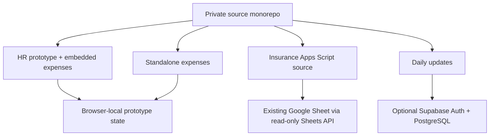

# Architecture: current implementation and integration boundary

## Current architecture

This is a **multi-app npm workspace monorepo**, using mostly browser JavaScript without a frontend framework. Node.js orchestrates checks, tests, preview and HR packaging; it is not currently a shared business API. It is not a microservices deployment and has no unified database.

The insurance arrow describes the existing separately deployed Google system. Running the suite does not connect to that system. Daily updates uses browser demo mode until its Supabase configuration is supplied. The HR insurance screen is still its own prototype fixture, not the live Google dashboard. The HR daily screen is also a separate prototype implementation, not a transparent mount of the standalone Supabase module.

## Source ownership

| Boundary | Canonical source | Synchronization |
| --- | --- | --- |
| HR experience | `apps/hr-portal/web` | Worker build packages assets behind its access gate |
| Expense behavior/UI | `apps/expenses/dist` | `npm run sync:expenses` copies assets into HR and records hashes |
| Insurance validation | `apps/insurance/logic.js` | `npm run sync:insurance` generates the Apps Script calculation core |
| Insurance Google access/read adapter | `apps/insurance/server/adapter.gs` | Same generator combines adapter + validation into deployable Code.gs |
| Insurance Google UI | `apps/insurance/apps-script/Dashboard.html` | Separate Apps Script deployment, not automatically published |
| Daily updates backend contract | Private optional SQL source; `apps/daily-updates/backend-check.mjs` | SQL excluded here; company implementation needs Django migrations |

Expense source lives in `dist` by historical convention. HR `dist/server` is generated build output. They must not be treated as the same kind of folder.

## Request and trust boundaries

- Local preview: loopback-only static server; no production authentication. Insurance serves only its local index/config/logic; server files, backups and historical HTML are blocked.
- HR Worker: validates trusted hosting identity headers and allowed company domain before serving assets. This depends on its original host. For company staging, replace/adapt the identity adapter to the chosen trusted SSO gateway. Never trust user-supplied identity headers on a publicly reachable origin.
- Expense prototype: role/account switching demonstrates permissions. Browser state cannot enforce production security; approval, ownership, duplicate and payout checks must become server transactions.
- Insurance: Apps Script calls the company-domain check on both page and data entry points; Sheets access is read-only and rejected claims are returned as count-only records. Keep deployment `DOMAIN` and `USER_DEPLOYING`.
- Daily updates: Supabase Auth plus PostgreSQL RLS/RPC enforce its own connected-mode model. No service-role credential belongs in browser config.

## Proposed company integration — not yet implemented

Use the company's existing identity provider and backend conventions. Give each employee an immutable ID and unique normalized company email; email is the payroll matching key, not a replacement for immutable identity. Share one server-authoritative role model. Introduce database-backed HR/expense services and private receipt storage, then integrate daily updates and the existing insurance read-only service through authenticated adapters.

A proposed shared PostgreSQL database is a design option, **not an installed suite-wide database**. Preserve the working insurance Google Sheet until a reviewed migration is approved. Payroll remains separate: export only approved reimbursement totals and employee matching fields, never base salaries.
